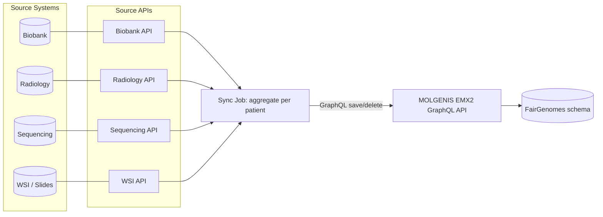
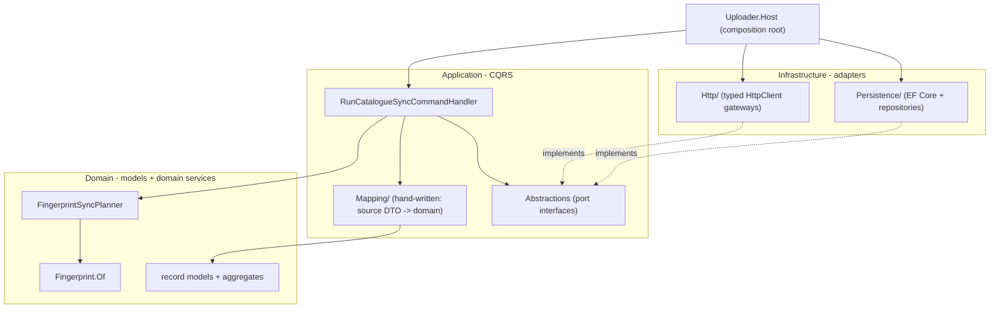
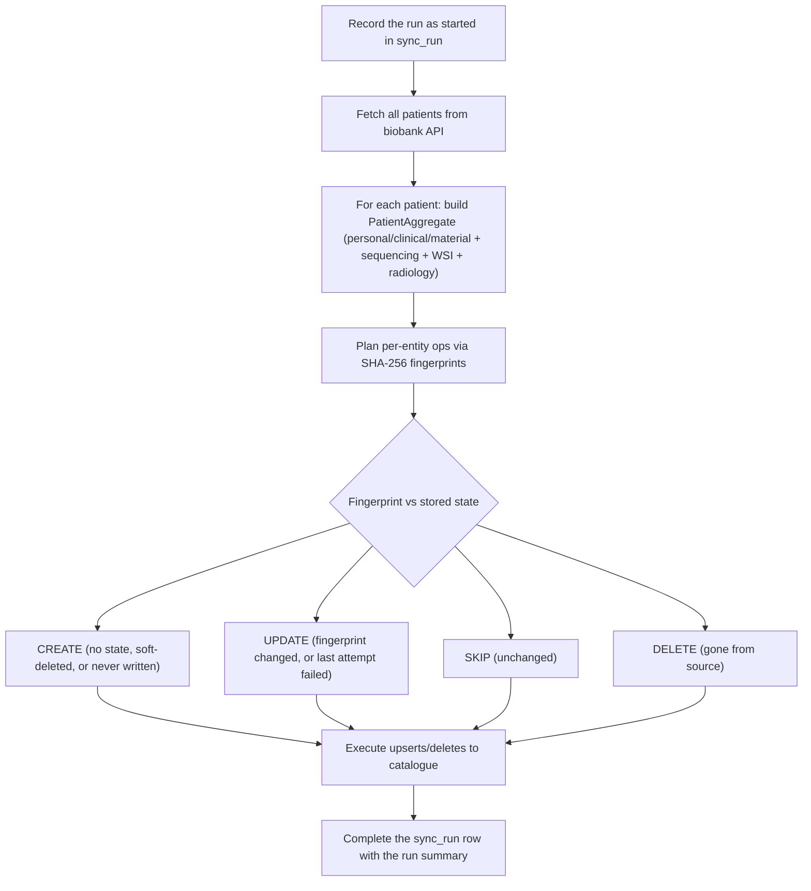
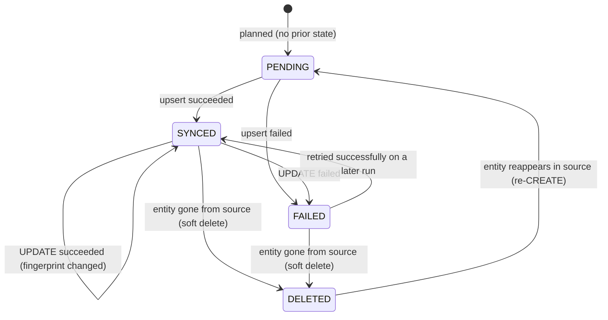

# Architecture Overview

> This repository is a **.NET solution** (`DataCatalogueUpload.slnx`). The services - the `uploader`
> sync service and the source APIs (`biobank_api` and `sequencing_api`) - live under `src/`.
> This document describes the **uploader** and the end-to-end data flow; each service follows the same
> Clean Architecture layering. See [`AGENTS.md`](AGENTS.md) for the solution layout.

The uploader synchronizes patient-related data from multiple source systems into the data catalogue.

At a high level:
- each source system exposes its own API,
- the sync job calls those APIs,
- it aggregates source data into one patient-level record,
- and upserts that record to the catalogue.

In one sentence: for each patient, the sync job reads from all source APIs, aggregates the data into one coherent record, and uploads it into the data catalogue.

## When a sync runs

`Uploader.Host` is a long-running ASP.NET Core host, like the two source APIs. A sync starts in one
of two ways, both through the singleton `SyncRunner`:

- the Quartz `SyncJob`, on `UPLOADER_SYNC_CRON` (default Mon/Wed/Fri 02:00 UTC, after the source
  APIs' Sunday ingests), and
- `POST /admin/sync`, which starts one in the background and answers `202` at once, or `409` while
  one is already running.

`SyncRunner` holds a one-slot lock, so the two never overlap: a scheduled turn that finds a manual
sync running is skipped, not queued. `GET /admin/sync` reports whether a sync is running and the
latest `sync_run` row. The source APIs start their ingests the same way (`IngestionRunner`,
`POST`/`GET /admin/ingest`).

## Code structure (Clean Architecture / layered)

The uploader's projects under `src/Uploader/` follow a strict dependency direction: `Host` -> `Infrastructure` -> `Application` -> `Domain`. The domain layer has no outward dependencies.

| Layer | Path | Responsibility |
|-------|------|----------------|
| Domain | `src/Uploader/Uploader.Domain/` | Record models + aggregates, the domain service `FingerprintSyncPlanner`, and the `Fingerprint` value object (SHA-256 over JSON) the planner compares. No I/O, no framework dependencies. |
| Application | `src/Uploader/Uploader.Application/` | CQRS `RunCatalogueSyncCommand` + handler, `Dtos/` + the hand-written mappers (`Mapping/`: one per source - `PatientMapper`, `SampleMapper`, `SequencingMapper`, `WsiMapper`, `ImagingStudyMapper` - plus `BiobankMapping` for the biobank's derived values), and the port interfaces in `Abstractions/`. Outbound, `CatalogueMapper` turns aggregates into the EMX2 rows under `Dtos/Catalogue/`, substituting a pseudonym for every real identifier - see [`docs/pseudonymization.md`](docs/pseudonymization.md). `CatalogueVocabulary` is where a biobank code becomes an ontology term. The handler also fingerprints each of those rows for the planner, so change detection sees exactly what the catalogue receives. |
| Infrastructure | `src/Uploader/Uploader.Infrastructure/` | Adapters implementing the ports: typed `HttpClient` gateways (`Http/`) and EF Core + repositories (`Persistence/`). |
| Host | `src/Uploader/Uploader.Host/` | Composition root and Minimal API (`GET /health`, `POST`/`GET /admin/sync`), plus `Scheduling/`: the Quartz `SyncJob` and the `SyncRunner` both triggers go through. |

The ports in `Uploader.Application/Abstractions` (`ISourceDataGateway`, `ICatalogueGateway`, `ISyncStateRepository`, `ISyncRunRepository`, `IPseudonymMap`) are interfaces. Infrastructure provides concrete implementations, and `Uploader.Host` wires them together from environment variables. Planning is a domain service (`ISyncPlanner`).

## Sync flow

0. **Record** the run in `sync_run` before any work, with no `finished_at`. A run cut short by a
   crash or a restart keeps that unfinished row, which is how `GET /admin/sync` tells it apart.
1. **Fetch** all patients from the biobank API (`GET /patients`).
2. **Aggregate** each patient: personal/clinical/material from the biobank payload, sequencing (by `predictive_number`), WSI (by `bioptic_number` - the biobank serves none, so this stays empty until #31), and radiology (by `accession_numbers`, patient-level and sample-level combined). Every source serves its own vocabulary; translating it into the catalogue's ontology terms is `CatalogueVocabulary`'s job, and a code with no term that means the same thing is left out rather than guessed at. The sequencing API answers with `samples[] -> runs[]` - a predictive number is not unique and a sample can be resequenced - which the uploader flattens into one FAIR `SamplePreparation` per (sample, run) pair. A predictive number belongs to a case, so every sample of one surgery carries it: each number is fetched once and hangs from one owner sample, which `SequencingOwner` picks with tumour tissue first. An unknown predictive number comes back `200` with an empty `samples`: no sequencing record, and not a failure.
3. **Plan** per-entity operations in dependency order using SHA-256 fingerprints of the rows the catalogue would receive (the handler builds each row with `CatalogueMapper` and hashes it with `Fingerprint.Of(...)`, so a mapping fix or a new study id re-sends a row whose source data did not change): CREATE when the entity was never successfully written (no prior state, a soft-deleted one, or no catalogue id yet), UPDATE when the fingerprint changed or the last attempt failed (the fingerprint is stored before the upsert, so a failure is retried rather than skipped), SKIP when unchanged, DELETE when entities disappear from the source.
4. **Execute** the plan against the catalogue's GraphQL API. One aggregate becomes several EMX2
   rows across several tables - a patient is a `Personal`, an `IndividualConsent` and a `Clinical` -
   written parents first, because each references the one before.
5. **Patients missing** from the current run are soft-deleted in the DB subtree, and deleted in the
   catalogue if they were ever published (`ISyncState.WasPublished`). Deletes run child before parent, deepest first: EMX2 refuses to remove a row another row
   still references, so any other order fails loudly instead of leaving orphans behind.
6. **Complete** the `sync_run` row with `finished_at` and the run summary (scanned / changed /
   uploaded / deleted / skipped / failed / source_unavailable). A run that ends before syncing
   anything - the study cannot be published, or the biobank cannot be listed - also records why,
   in `failure`.

Upload eligibility: a patient is only uploaded if they consented and have at least one sample (`PatientCatalogueData.IsUploadEligible`). Consent is checked explicitly rather than being left to follow from the biobank refusing to attach samples to a non-consenting patient. An ineligible patient who was ever published (`ISyncState.WasPublished`: it has a catalogue id, or an upsert failed part-way) is deleted after its children; one who never was gets no operation at all and leaves no sync state, so a later run cannot mistake it for a published patient.

## Sync state machine

Two enums in `Uploader.Domain/Sync/SyncState.cs` drive change detection. They are distinct concepts:

- **`SyncOp`** is the *decision* the planner makes for an entity on this run: `CREATE`, `UPDATE`, `SKIP`, or `DELETE`.
- **`SyncStatus`** is the *persisted state* of an entity in the DB between runs: `PENDING`, `SYNCED`, `FAILED`, or `DELETED`.

Each entity (patient, sample, sequencing, WSI, imaging study) carries its own state, persisted in its per-entity `*_sync_state` table alongside the fingerprint.

| Status | Meaning | Set when |
|--------|---------|----------|
| `PENDING` | Planned this run, not yet executed (also the default for a brand-new entity). | Planner creates a new state, or no prior state exists (`FingerprintSyncPlanner`). |
| `SYNCED` | Successfully upserted to the catalogue. | Execution of a `CREATE`/`UPDATE` op succeeds (`RunCatalogueSyncCommandHandler`). |
| `FAILED` | The upsert/delete for this entity failed; the run continues for others. | The catalogue gateway returns an error for an op (`RunCatalogueSyncCommandHandler`). |
| `DELETED` | Entity disappeared from the source; deleted in the catalogue and soft-deleted in the DB. | Planner emits a `DELETE` op, or the repository soft-deletes a subtree (`FingerprintSyncPlanner`, `SyncStateRepository`). |

A soft-deleted (`DELETED`) entity that reappears in the source is treated as a fresh `CREATE` on the next run, returning it to `PENDING` → `SYNCED`.
