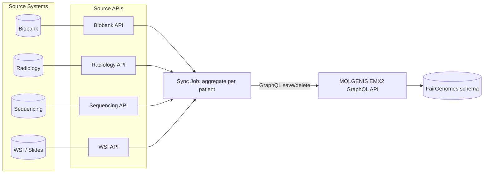
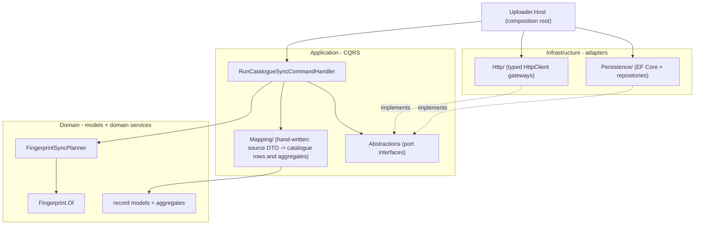
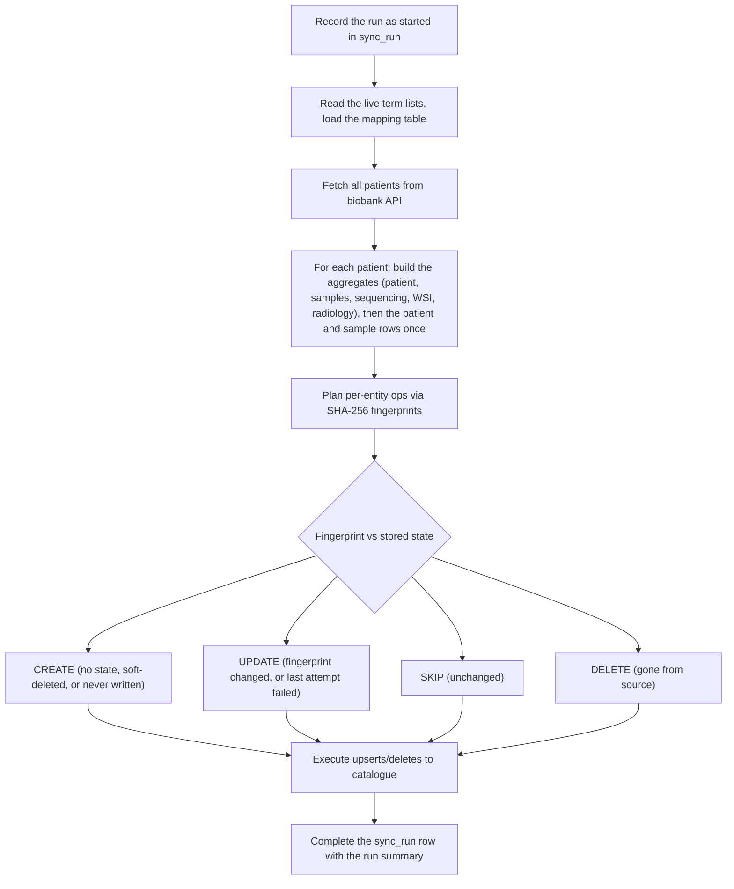
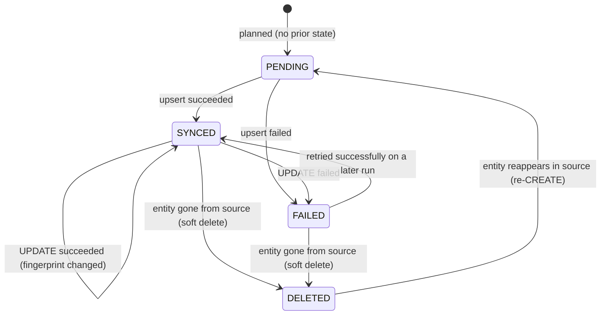

# Architecture Overview

> This repository is a **.NET solution** (`DataCatalogueUpload.slnx`). The services - the `uploader`
> sync service and the source APIs (`biobank_api` and `sequencing_api`) - live under `src/`.
> This document describes the **uploader** and the end-to-end data flow; each service follows the same
> Clean Architecture layering. See [`AGENTS.md`](AGENTS.md) for the solution layout.

The uploader synchronizes patient-related data from multiple source systems into the data catalogue.

At a high level:
- each source system exposes its own API,
- the sync job calls those APIs,
- it aggregates source data into one patient-level record,
- and upserts that record to the catalogue.

In one sentence: for each patient, the sync job reads from all source APIs, aggregates the data into one coherent record, and uploads it into the data catalogue.

## When a sync runs

`Uploader.Host` is a long-running ASP.NET Core host, like the two source APIs. A sync starts in one
of two ways, both through the singleton `SyncRunner`:

- the Quartz `SyncJob`, on `UPLOADER_SYNC_CRON` (default Mon/Wed/Fri 02:00 UTC, after the source
  APIs' Sunday ingests), and
- `POST /admin/sync`, which starts one in the background and answers `202` at once, or `409` while
  one is already running.

`SyncRunner` holds a one-slot lock, so the two never overlap: a scheduled turn that finds a manual
sync running is skipped, not queued. `GET /admin/sync` reports whether a sync is running and the
latest `sync_run` row. The source APIs start their ingests the same way (`IngestionRunner`,
`POST`/`GET /admin/ingest`).

## Code structure (Clean Architecture / layered)

The uploader's projects under `src/Uploader/` follow a strict dependency direction: `Host` -> `Infrastructure` -> `Application` -> `Domain`. The domain layer has no outward dependencies.

| Layer | Path | Responsibility |
|-------|------|----------------|
| Domain | `src/Uploader/Uploader.Domain/` | The aggregates the planner reads - patient (id, consent), sample (id, patient, sequencing and WSI links) and sequencing (predictive number, owning sample) carry no copy of the catalogue row; WSI and imaging keep their value objects - plus the domain service `FingerprintSyncPlanner`, and the `Fingerprint` value object (SHA-256 over JSON) the planner compares. No I/O, no framework dependencies. |
| Application | `src/Uploader/Uploader.Application/` | CQRS `RunCatalogueSyncCommand` + handler, `Dtos/` + the hand-written mappers (`Mapping/`), and the port interfaces in `Abstractions/`. The biobank and sequencing responses go straight to the EMX2 rows under `Dtos/Catalogue/`: `CataloguePatientMapper`, `CatalogueSampleMapper` and `CatalogueSequencingMapper` build each payload and its thin aggregate, placing values and substituting a pseudonym for every real identifier in one step - see [`docs/pseudonymization.md`](docs/pseudonymization.md). WSI and radiology still map to an aggregate first (`WsiMapper`, `ImagingStudyMapper`). `BiobankMapping` holds the biobank's derived values and `SequencingMapping` the derived FAIR identifiers, the constant sequencing method and the packed quality metrics. A source value becomes an ontology term through the run's `TermResolver` (`Mapping/Ontology/`) - a live term as is, else the `IMappingTable` port, whose stand-in `RuleMappingTable` hands every run `RuleMappingSnapshot` with today's rules - for all 18 ontology fields - the patient's, the sample's (a material code looked up with its sample type and label as context) and the sequencing's (kits, gene symbols with their star, platform, instrument serial, file roles, reference-genome alias) - see [`docs/ontology-mapping.md`](docs/ontology-mapping.md). The handler builds each patient, sample and sequencing payload once per run and fingerprints that same object for the planner, so change detection sees exactly what the catalogue receives. |
| Infrastructure | `src/Uploader/Uploader.Infrastructure/` | Adapters implementing the ports: typed `HttpClient` gateways (`Http/`) and EF Core + repositories (`Persistence/`). |
| Host | `src/Uploader/Uploader.Host/` | Composition root and Minimal API (`GET /health`, `POST`/`GET /admin/sync`, `GET /admin/ontology/unmapped`), plus `Scheduling/`: the Quartz `SyncJob` and the `SyncRunner` both triggers go through. |

The ports in `Uploader.Application/Abstractions` (`ISourceDataGateway`, `ICatalogueGateway`, `ISyncStateRepository`, `ISyncRunRepository`, `IUnmappedValueRepository`, `IPseudonymMap`, `IMappingTable`) are interfaces. Infrastructure provides concrete implementations, and `Uploader.Host` wires them together from environment variables. Planning is a domain service (`ISyncPlanner`).

## Sync flow

0. **Record** the run in `sync_run` before any work, with no `finished_at`. A run cut short by a
   crash or a restart keeps that unfinished row, which is how `GET /admin/sync` tells it apart. Then
   publish the study, read the live term list of every ontology field the uploader fills, and load
   the mapping table - once each, before the first patient, so every value is resolved against them.
1. **Fetch** all patients from the biobank API (`GET /patients`).
2. **Aggregate** each patient: the patient and sample identities and links from the biobank payload, sequencing (by `predictive_number`), WSI (by `bioptic_number` - the biobank serves none, so this stays empty until #31), and radiology (by `accession_numbers`, patient-level and sample-level combined). Every source serves its own vocabulary, and a code with no term that means the same thing is left out rather than guessed at. Every ontology value - the patient's, the sample's and the sequencing's - is resolved by the run's `TermResolver` while its row is built, before it is fingerprinted, and a value it cannot place is left out of a row that still goes out, counted once per row that held it and logged once per run as unmapped (only for an upload-eligible patient). The sequencing API answers with `samples[] -> runs[]` - a predictive number is not unique and a sample can be resequenced - which the uploader flattens into one FAIR `SamplePreparation` per (sample, run) pair, MammaPrint runs left out. A predictive number belongs to a case, so every sample of one surgery carries it: each number is fetched once and hangs from one owner sample, which `SequencingOwner` picks with tumour tissue first. An unknown predictive number comes back `200` with an empty `samples`, and a number sequenced only for MammaPrint has nothing left either: no sequencing aggregate, and not a failure. Once the patient's pseudonyms are resolved, `CataloguePatientMapper` and `CatalogueSampleMapper` build the patient and sample rows straight from the biobank payload, and `CatalogueSequencingMapper` the sequencing rows straight from the sequencing response under the owner's pseudonym, once per run.
3. **Plan** per-entity operations in dependency order using SHA-256 fingerprints of the rows the catalogue would receive (the handler hashes each row with `Fingerprint.Of(...)` - the patient, sample and sequencing rows it built in step 2 - and the upsert sends the very objects that were hashed, so a mapping fix or a new study id re-sends a row whose source data did not change): CREATE when the entity was never successfully written (no prior state, a soft-deleted one, or no catalogue id yet), UPDATE when the fingerprint changed or the last attempt failed (the fingerprint is stored before the upsert, so a failure is retried rather than skipped), SKIP when unchanged, DELETE when entities disappear from the source.
4. **Execute** the plan against the catalogue's GraphQL API. One aggregate becomes several EMX2
   rows across several tables - a patient is a `Personal`, an `IndividualConsent` and a `Clinical` -
   written parents first, because each references the one before.
5. **Patients missing** from the current run are soft-deleted in the DB subtree, and deleted in the
   catalogue if they were ever published (`ISyncState.WasPublished`). Deletes run child before parent, deepest first: EMX2 refuses to remove a row another row
   still references, so any other order fails loudly instead of leaving orphans behind.
6. **Record the unmapped list** in `unmapped_value`: each distinct value the run left unmapped, with
   the number of rows that held it. A run every source answered replaces the list; one a source did
   not answer only adds and updates, so an outage does not empty it. `GET /admin/ontology/unmapped`
   serves it to the ontology-mapping student - see [`docs/ontology-mapping.md`](docs/ontology-mapping.md).
7. **Complete** the `sync_run` row with `finished_at` and the run summary (scanned / changed /
   uploaded / deleted / skipped / failed / source_unavailable / unmapped). A run that ends before syncing
   anything - the study cannot be published, the term lists cannot be read or name a column that is
   not an ontology, the mapping table cannot be loaded, or the biobank cannot be listed - also
   records why, in `failure`.

Upload eligibility: a patient is only uploaded if they consented and have at least one sample (`PatientCatalogueData.IsUploadEligible`). Consent is checked explicitly rather than being left to follow from the biobank refusing to attach samples to a non-consenting patient. An ineligible patient who was ever published (`ISyncState.WasPublished`: it has a catalogue id, or an upsert failed part-way) is deleted after its children; one who never was gets no operation at all and leaves no sync state, so a later run cannot mistake it for a published patient.

## Sync state machine

Two enums in `Uploader.Domain/Sync/SyncState.cs` drive change detection. They are distinct concepts:

- **`SyncOp`** is the *decision* the planner makes for an entity on this run: `CREATE`, `UPDATE`, `SKIP`, or `DELETE`.
- **`SyncStatus`** is the *persisted state* of an entity in the DB between runs: `PENDING`, `SYNCED`, `FAILED`, or `DELETED`.

Each entity (patient, sample, sequencing, WSI, imaging study) carries its own state, persisted in its per-entity `*_sync_state` table alongside the fingerprint.

| Status | Meaning | Set when |
|--------|---------|----------|
| `PENDING` | Planned this run, not yet executed (also the default for a brand-new entity). | Planner creates a new state, or no prior state exists (`FingerprintSyncPlanner`). |
| `SYNCED` | Successfully upserted to the catalogue. | Execution of a `CREATE`/`UPDATE` op succeeds (`RunCatalogueSyncCommandHandler`). |
| `FAILED` | The upsert/delete for this entity failed; the run continues for others. | The catalogue gateway returns an error for an op (`RunCatalogueSyncCommandHandler`). |
| `DELETED` | Entity disappeared from the source; deleted in the catalogue and soft-deleted in the DB. | Planner emits a `DELETE` op, or the repository soft-deletes a subtree (`FingerprintSyncPlanner`, `SyncStateRepository`). |

A soft-deleted (`DELETED`) entity that reappears in the source is treated as a fresh `CREATE` on the next run, returning it to `PENDING` → `SYNCED`.
